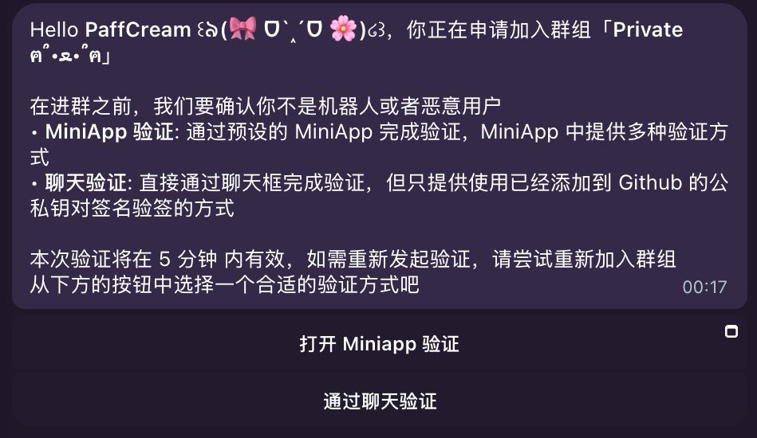

# Paffbot

这是一个基于 Cloudflare Worker 的 Telegram 入群管理 Bot，能够以合适的方式通过他人的入群申请。

在设计上，目前 Bot 具有三种入群验证方式

- Github SSH 签名：使用添加到 Github 的 SSH 公钥对应的私钥对给定的内容进行签名，并将签名回贴到 Bot 进行验证
- Github OAuth：直接进行 Github 登录的方式进行验证
- 人机验证：这个是针对于没有 Github 的用户，通过 Cloudflare Turnstile 或者自建 [capjs](https://github.com/tiagozip/cap) 实例进行验证，人机验证通过后仍需要管理员在群内找到对应的消息手动通过

## 预览

|  |      |      |      |      |
| :-------------------------------------------: | ---- | ---- | ---- | ---- |
|                 私聊认证信息                  |      |      |      |      |

