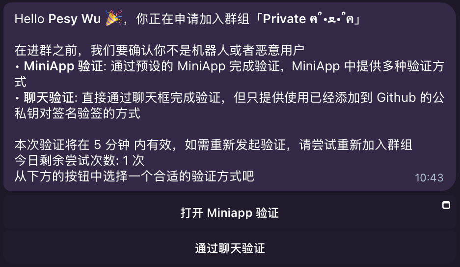
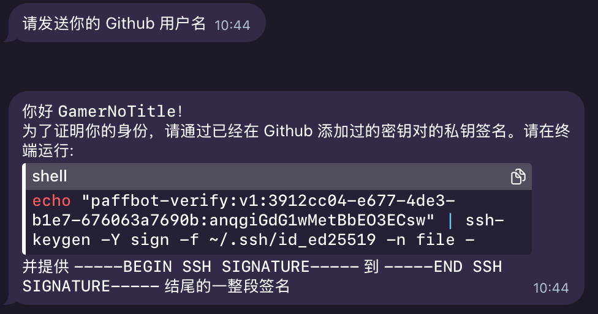
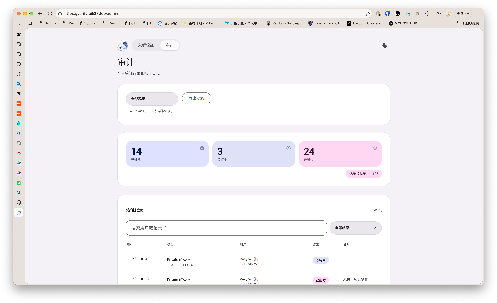
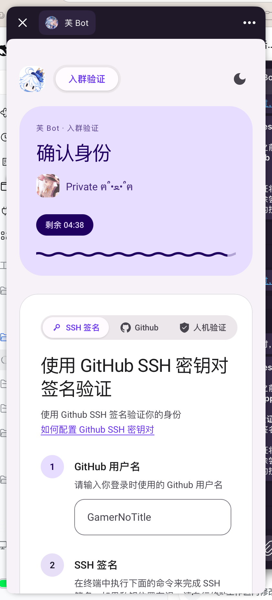
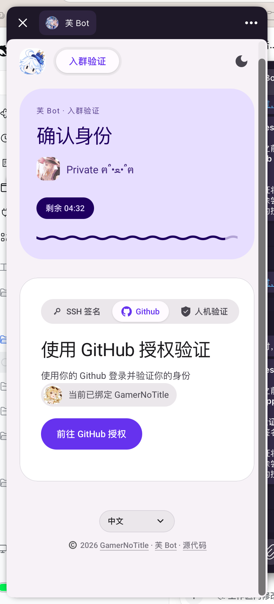
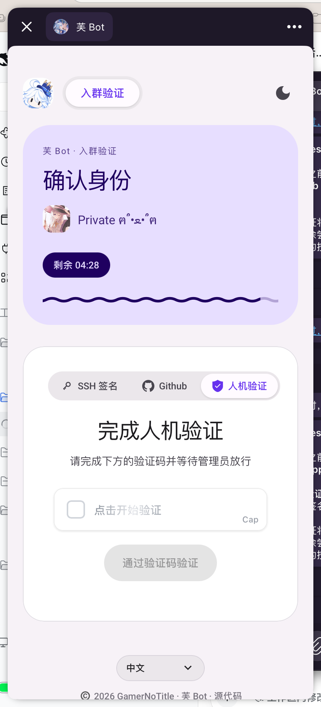

# Paffbot

这是一个基于 Cloudflare Worker 的 Telegram 入群管理 Bot，能够以合适的方式通过他人的入群申请。

在设计上，目前 Bot 具有三种入群验证方式

- Github SSH 签名：使用添加到 Github 的 SSH 公钥对应的私钥对给定的内容进行签名，并将签名回贴到 Bot 进行验证
- Github OAuth：直接进行 Github 登录的方式进行验证
- 人机验证：这个是针对于没有 Github 的用户，通过 Cloudflare Turnstile 或者自建 [capjs](https://github.com/tiagozip/cap) 实例进行验证，人机验证通过后仍需要管理员在群内找到对应的消息手动通过

考虑到部分用户可能无法正常打开 Telegram Miniapp，所以仍然在聊天过程中提供且仅提供 Github SSH 签名验证方式

## 预览

|  |  |  |
| :---: | :---: | :---: |
| 私聊认证信息 | 通过聊天验证 | 入群记录审计 |
|  |  |  |
| SSH 签名 | Github OAuth | 人机验证 |

## 快速开始

在部署之前，请确认你具有

- Cloudflare 账号
- Github 账号
- 找 @BotFather 获取 Bot 的 token
- （建议）拥有一个域名

首先，你需要安装一下 wrangler 并完成登录

```bash
npm install
npm wrangler login
```

登录完成后，需要在 Cloudflare D1 上新建一个数据库

```bash
npx wrangler d1 create paffbot
```

这里的 `paffbot` 可以是任意名字，主要用于区分，这里运行完毕后会输出数据库的 id，将其填入 `wrangler.jsonc` 中

```json
  "d1_databases": [
    {
      "binding": "DB",
      "database_name": "<YOUR_NAME_HERE>",
      "database_id": "<YOUR_DATABASE_ID_HERE>",
      "migrations_dir": "migrations"
    }
  ],
```

填入完毕后，我们要进行数据库的初始化，这里直接运行下面的命令即可

```bash
npx wrangler d1 migrations apply DB --remote
```

完成后，我们进入环境配置。虽然大部分设置都在网页中进行，但是有少部分必须通过环境变量进行

```bash
npx wrangler secret put BOT_TOKEN        # BotFather 给的 token
npx wrangler secret put WEBHOOK_SECRET   # 至少 16 位，URL 路径段，同时也用于 WEBHOOK 的认证
npx wrangler secret put ADMIN_IDS        # 你的 Telegram 数字 id
npx wrangler secret put SETTINGS_KEY		 # （可选）用于设置凭据加密的密钥，虽然不填会使用 BOT_TOKEN，但是考虑到使用中可能会在 BotFather 那里进行 Token 轮换，所以强烈建议配置一下，以免出现解不开数据库的问题
```

你可以使用以下命令生成随机字符串

```bash
openssl rand -hex 32
```

完成后，我们进行部署

```bash
npm run deploy
```

部署完毕后，可以通过 `/health` 路由确定服务存活状态

最后我们设置一下 webhook，通过以下命令进行

```bash
npm run webhook -- --url https://<YOUR_DOMAIN>
```

如果你在 Worker 上绑定了自定义域名，那就用自定义域名即可，否则使用 `.workers.dev` 可能会出现国内无法访问的问题

剩余设置都可以在对应的设置页面完成，通过你上面使用的数字 ID 对应的 Telegram 账户，在左下角找到 `Open App` 进入设置即可，也可以直接在浏览器访问对应的网页使用 Telegram 进行认证

## 安全提醒

在设计上，本 Bot 未考虑多管理多群的使用情景，所以尽量不要将你的芙 Bot 实例共享给他人使用，只在自己管理的群组范围内进行使用


